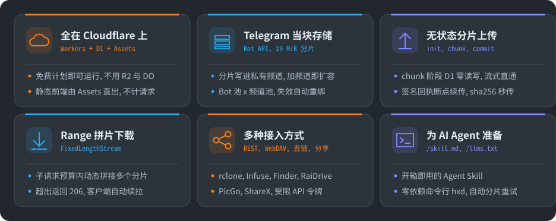
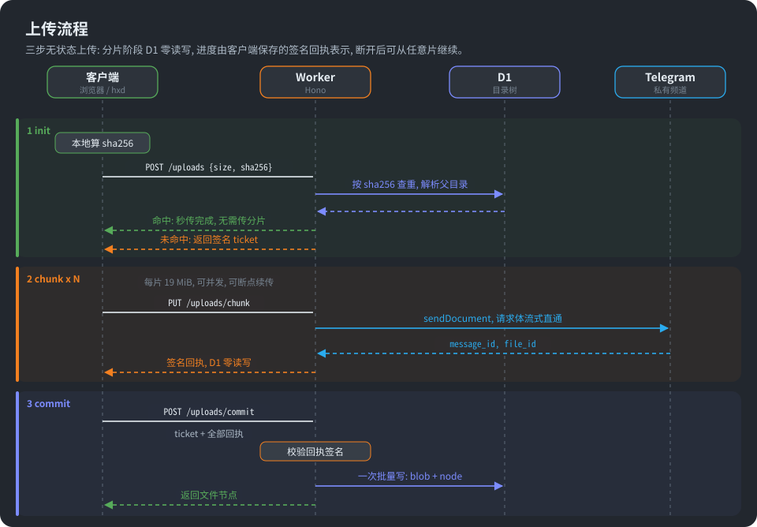
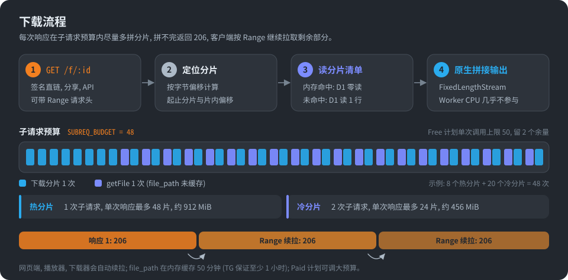
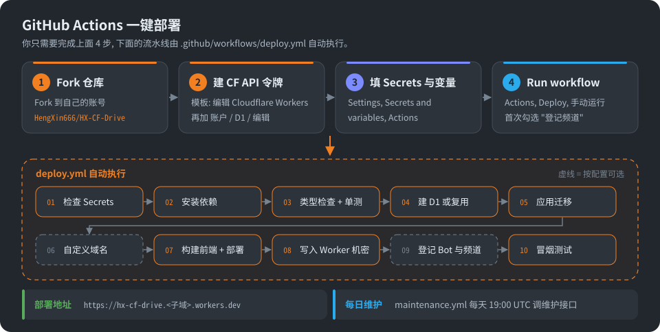
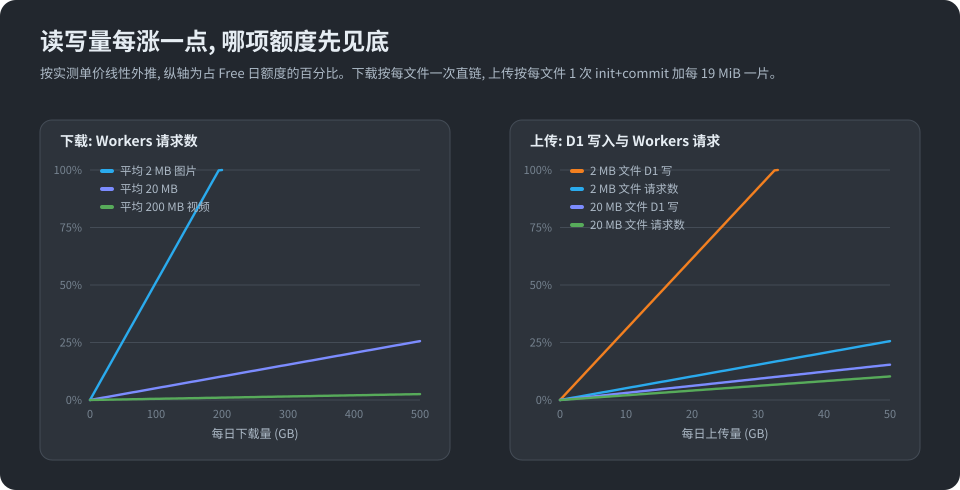

<div align="center">


<h1>HX-CF-Drive</h1>

<p><b>全部跑在 Cloudflare 上的网盘网关, 把 Telegram 私有频道当作块存储。</b></p>

<p>目录树放在 D1, 文件切成 19 MiB 分片存进 Telegram, 不使用 R2 和 Durable Object。<br>对外提供 REST API, WebDAV, 签名直链, 分享链接, 以及给 AI Agent 用的 Skill 和命令行。</p>

<p>
<a href="https://github.com/HengXin666/HX-CF-Drive/blob/main/LICENSE"></a>
<a href="https://workers.cloudflare.com/"></a>
<a href="https://developers.cloudflare.com/d1/"></a>
<a href="https://core.telegram.org/bots/api"></a>
<a href="https://www.typescriptlang.org/"></a>
<a href="https://react.dev/"></a>
<a href="https://hono.dev/"></a>
</p>

<p>
<a href="https://hengxin666.github.io/HX-CF-Drive/"></a><br>
<a href="https://hengxin666.github.io/HX-CF-Drive/"><b>在线演示 (纯前端)</b></a>: 接口在浏览器内模拟, 数据只存在你的浏览器里, 不连接任何后端或 Telegram
</p>

<p>
<a href="#-快速开始">快速开始</a> |
<a href="docs/DEPLOY.md">部署指南</a> |
<a href="docs/INTEGRATION.md">接入文档</a> |
<a href="docs/QUOTA.md">额度分析</a> |
<a href="docs/COMPARISON.md">方案对比</a>
</p>

</div>

---

## ✨ 特性

<p align="center"></p>

v0.2 的目标只有两个: Cloudflare 各项额度尽量少用, Worker CPU 尽量低。具体做法:

- **上传无状态**: 分片阶段 D1 零读写, 请求体流式直通 Telegram, 整个文件只在 commit 时批量写一次。
- **读文件只读 1 行**: 分片清单整体存成一行 JSON, 清单, file_path, 节点都缓存在 isolate 内存, 热文件 D1 零读。
- **不用 Durable Object**: Bot 冷却放内存, TG 429 原样回给客户端按 Retry-After 重试, 下次自动换 Bot。
- **不写流水账**: 去掉审计日志, 分享计数, 令牌最后使用时间等每次操作都要写的行。
- **CPU 很低**: 下载由 FixedLengthStream 原生搬运, 上传不再 `arrayBuffer()`, 服务端不算哈希。
- **静态前端不进 Worker**: 由 Assets 直接返回, 不计 Workers 请求数。

> [!NOTE]
> 文中 D1 行数来自本地实测 (`wrangler dev` + 模拟 Telegram), CPU 时间来自线上实测。详见 [docs/QUOTA.md](docs/QUOTA.md)。

## 🧭 架构

<p align="center"></p>

- 请求先匹配 Assets 静态文件 (`run_worker_first = false`), 只有 `/api` `/dav` `/f` `/s` 才进 Worker。
- Worker 用 Hono 挂载 REST, WebDAV, 签名直链和分享四组路由, 元数据读写走 D1, 文件内容走 Telegram Bot API。
- Bot 池 x 频道池: 写入按 blob id 哈希打散到所有可写频道; Bot 失效时用另一个 Bot 转发原消息拿新 file_id。
- 每日维护 (Bot 探活, 回收站清理, 删除孤儿分片) 默认由 GitHub Actions 调接口触发, 不占 Free 账户的 Cron 名额。

<details>
<summary><b>目录结构</b></summary>

```
src/
  index.ts                   入口, 路由挂载, 定时任务
  env.ts                     绑定与类型
  drivers/tg.ts              Telegram 驱动 (上传, 下载, Bot 池, 重新绑定)
  lib/                       鉴权, 目录树, Range, 签名, D1 计量, 工具函数
  routes/api.ts              REST API
  routes/dav.ts              WebDAV
  routes/public.ts           签名直链与分享
  services/upload.ts         无状态分片上传 (签名凭证 + 回执)
  services/serve.ts          读取与流式拼接
  services/maintenance.ts    定时维护
migrations/                  D1 表结构
web/                         前端 (React + TS + HX-UI), 构建到 dist/web 由 Assets 直接返回
  src/lib/transfer.ts        浏览器端 sha256 秒传, 断点续传, 大文件 Range 续拉
skills/hx-cf-drive/          给 AI Agent 的 Skill 与命令行脚本
scripts/quota.mjs            免费额度估算 (按实测单次行数)
scripts/meter.mjs            实测每个操作的 D1 行读写
scripts/mock-tg.mjs          本地模拟 Telegram
scripts/e2e.mjs              端到端冒烟测试
test/                        单元测试
docs/                        部署, 额度, 接入, Telegram 配置, 方案对比
```

</details>

## 📤 上传流程

<p align="center"></p>

| 阶段 | 接口 | D1 | Telegram |
| --- | --- | --- | --- |
| init | `POST /api/v1/uploads` | 只读查重与解析路径, 新目录才写 | 0 |
| chunk | `PUT /api/v1/uploads/chunk` | **零读写** | 每片 1 次 `sendDocument` |
| commit | `POST /api/v1/uploads/commit` | 一次批量写 (blob + node, 含索引约 6 行) | 0 |
| 秒传 | `POST /api/v1/uploads` 命中 sha256 | 一次请求完成, 写约 4 行 (含索引) | 0 |

- 浏览器端先算 sha256, 命中已有 blob 时 1 次请求完成上传。
- 每个分片返回一张签名回执, 客户端保存回执即可断点续传, 服务端不保存任何上传中的状态。
- 小文件也可以用 `POST /api/v1/upload` 一次性上传 (multipart 或 raw), 适合 PicGo 和 ShareX。

## 📥 下载流程

<p align="center"></p>

- Free 计划单次调用最多 50 个外部子请求, 默认预算 `SUBREQ_BUDGET = 48`。冷分片 2 次 (getFile + 下载), 热分片 1 次。
- 单次响应冷拼最多 24 片 (约 456 MiB), 热拼最多 48 片, 超出部分返回 206, 网页端, 播放器, 下载器按 Range 续拉。
- file_path 在 isolate 内存里缓存 50 分钟 (Telegram 保证至少有效 1 小时), 热文件不再调用 getFile。
- Workers Paid 计划子请求上限 10,000, 调大 `SUBREQ_BUDGET` 即可一次拼更多片。

## ⚖️ 与同类项目

| | [CloudFlare-ImgBed](https://github.com/MarSeventh/CloudFlare-ImgBed) | [Teldrive](https://github.com/tgdrive/teldrive) | HX-CF-Drive |
| --- | --- | --- | --- |
| 运行环境 | CF Pages / Workers | 自有服务器 + PostgreSQL | CF Workers + D1 |
| Telegram 接入 | Bot API, 20 MB 分片 | 真人账号 (MTProto) + Bot | Bot API, 19 MiB 分片 |
| 其他存储后端 | R2, S3, Discord 等 | 无 | 无, 只用 TG |
| Web 界面与生态 | 完整, 社区活跃 | 完整 | 简洁, 个人项目 |
| 侧重点 | 图床 + 文件管理, 功能全 | 网盘, rclone 集成 | 额度占用低, 无状态上传, Agent 接入 |

如果你需要成熟完整的图床与文件管理, CloudFlare-ImgBed 是更稳妥的选择。HX-CF-Drive 更适合想把额度压到最低, 或者要让 AI Agent 直接读写网盘的场景。完整对比见 [docs/COMPARISON.md](docs/COMPARISON.md)。

## 🚀 快速开始

### 部署到 Cloudflare (推荐)

<a href="docs/DEPLOY.md"></a>

Fork 仓库, 建一个 Cloudflare API 令牌, 填好仓库 Secrets, 在 Actions 里点一次 Run workflow。D1 建库, 迁移, 测试, 部署, 写机密, 登记频道和冒烟全部自动完成。图文步骤见 **[部署指南](docs/DEPLOY.md)**。

### 本地开发

```bash
npm install
npm install --prefix web
cp .dev.vars.example .dev.vars
npm run db:migrate:local
node scripts/mock-tg.mjs 8887 &  # 模拟 Telegram, .dev.vars 里设 TG_API_BASE=http://127.0.0.1:8887
npm run dev                      # Worker, 8787
npm run dev:web                  # 前端热更新, 5173, 接口代理到 8787
npm test                         # 单元测试
node scripts/e2e.mjs             # 端到端冒烟
```

## 🖥️ 前端

`web/` 是 React + TypeScript 前端, UI 用 [HX-UI](https://github.com/HengXin666/HX-UI), 只用暗色主题, 侧栏可切换 5 套皮肤, 图标全部为 SVG (Iconify Solar)。

- 令牌登录, 目录浏览, 拖放上传 (sha256 秒传, 断点续传, 同名可覆盖或保留两者)。
- 图片, 视频, 音频, PDF, 文本预览, 大文件分段下载。
- 重命名, 移动, 删除, 回收站, 搜索, 分享与永久直链。
- 后台: 统计, 频道, Bot, 令牌, 手动维护, 以及内置接口文档页 (`/#/docs`)。

`npm run build:web` 构建到 `dist/web`, 部署时作为静态资源上传。HX-UI 尚未发布到 npm, 暂以 `web/vendor/hx-ui-*.tgz` 引入。

## 🤖 接入与 Agent

| 方式 | 说明 |
| --- | --- |
| REST API | `/api/v1`, 支持受限令牌 (按权限和目录隔离), 全部接口带 curl 示例 |
| WebDAV | `/dav`, 可挂到 rclone, RaiDrive, Finder, Infuse, OpenList |
| 直链与分享 | `/f/:id` 签名永久直链, `/s/:id` 分享链接 |
| 图床工具 | PicGo, ShareX 走一次性上传接口 |
| Agent Skill | [`skills/hx-cf-drive/SKILL.md`](skills/hx-cf-drive/SKILL.md), 部署后也发布在 `/skill.md` |
| 命令行 | `skills/hx-cf-drive/scripts/hxd.mjs`, 无依赖, 自动分片, 秒传, 429 重试, Range 续拉 |
| LLM 索引 | `/llms.txt` |

让 Agent 接入只需一句话:

```text
读取 https://你的域名/skill.md, 按其中说明使用 HX-CF-Drive, BASE=..., TOKEN=<受限令牌>
```

## 📊 实测

2026-11-25 线上轻量实测 (Workers Free, 149 次计量请求)。CPU 和 D1 行数来自 Cloudflare GraphQL, 不是推算。

<p align="center"></p>
<p align="center"></p>

- 每个请求 CPU 中位数 1 到 6 ms, D1 只在元数据操作时读写, R2 为 0。
- 下载先见底的是 Workers 请求数 (平均 20 MB 文件约 1.9 TB/天), 大量小文件上传先见底的是 D1 写入 (约 1.6 万个/天)。
- 单 Bot 单频道约 20 条/分就会被 TG 限流, 量大请加 Bot 和频道。

完整报告见 [docs/BENCHMARK.md](docs/BENCHMARK.md)。

## 📚 文档

| 文档 | 内容 |
| --- | --- |
| [docs/DEPLOY.md](docs/DEPLOY.md) | 图文部署指南: GitHub Actions 一键部署, 手动部署, 升级, 备份 |
| [docs/TELEGRAM.md](docs/TELEGRAM.md) | 存储小号, 私有频道, Bot 池配置与风控 |
| [docs/INTEGRATION.md](docs/INTEGRATION.md) | API, WebDAV, PicGo, ShareX, rclone 接入 |
| [docs/BENCHMARK.md](docs/BENCHMARK.md) | 线上实测报告: 每个接口的耗时, CPU, D1 行数, 额度外推 |
| [docs/QUOTA.md](docs/QUOTA.md) | 每个操作的请求量与 D1 行读写, 免费额度占用 |
| [docs/COMPARISON.md](docs/COMPARISON.md) | 与 CloudFlare-ImgBed, Teldrive 等方案对比 |

## ⚠️ 已知限制

<details>
<summary>展开查看</summary>

- Telegram 单分片 ≤ 20 MB (getFile 上限), 因此固定 19 MiB 分片。
- Free 计划单次响应冷拼 24 片, 热拼 48 片, 超出部分 206 截断。不带 Range 的客户端 (如 curl 直接下大文件) 只能拿到第一段。
- Cache API 在 `*.workers.dev` 上不生效, 边缘缓存需要绑定自定义域名。
- 搜索用 `LIKE '%q%'`, 未命中时扫全表, 是 D1 读行的主要来源, 已按令牌限频 (`SEARCH_PER_MIN`, 默认 6/分)。
- WebDAV 的 LOCK 是假锁, 只为兼容 Windows 和 Finder。
- 不支持空文件 (0 字节)。
- 同一分片被并发重传时, 频道里可能多出一条无引用消息, 只占频道空间, 由每日维护清理。
- 上传路径的 CPU 时间尚未在线上实测, 部署后用 `wrangler tail` 看 `cpuTime`。

</details>
