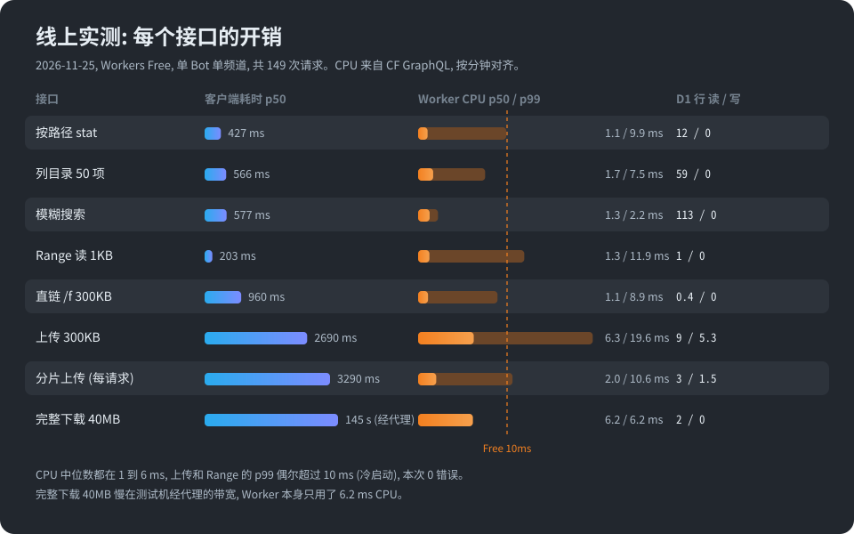
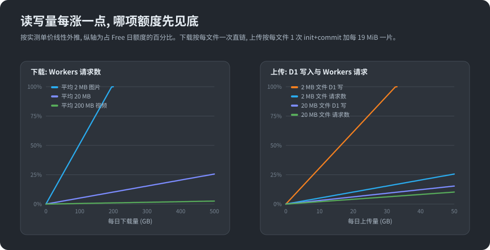
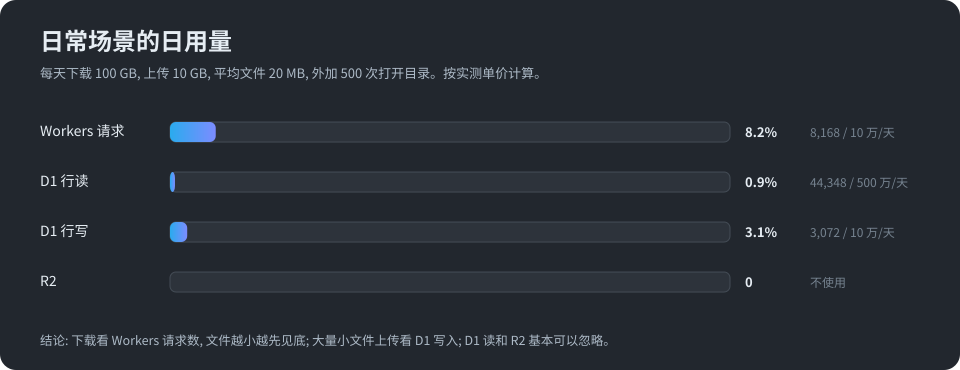

# 线上实测报告

2026-11-25 在线上 (Workers Free, 自定义域名, 单 Bot 单频道) 跑的一轮轻量实测, 共 149 次计量请求, 上传约 90 MB 到 Telegram, 不到 Free 日额度的 1%。

- 客户端耗时: `scripts/bench.mjs` 在作者本机 (经代理) 测得。
- Worker CPU, 子请求, D1 行读写: 每类操作独占一个整分钟, 再由 `.github/workflows/bench.yml` 调 `scripts/cfstats.mjs` 从 Cloudflare GraphQL 按分钟取出, 与 CF 后台口径一致。
- 原始数据: [docs/bench/2026-11-25.json](bench/2026-11-25.json)。

## 1. 每个接口的开销

<p align="center"></p>

| 接口 | 客户端 p50 | 客户端 p90 | CPU p50 | CPU p99 | D1 行读 / 次 | D1 行写 / 次 |
| --- | --- | --- | --- | --- | --- | --- |
| 按路径 stat | 427 ms | 1522 ms | 1.1 ms | 9.9 ms | 12 | 0 |
| 列目录 (50 项) | 566 ms | 1150 ms | 1.7 ms | 7.5 ms | 59 | 0 |
| 模糊搜索 (约 110 节点) | 577 ms | 2098 ms | 1.3 ms | 2.2 ms | 113 | 0 |
| Range 读 1 KB | 203 ms | 1128 ms | 1.3 ms | 11.9 ms | 约 1 | 0 |
| 签名直链 /f 300 KB | 960 ms | 2441 ms | 1.1 ms | 8.9 ms | 约 0.4 | 0 |
| 一次性上传 300 KB | 2690 ms | 5161 ms | 6.3 ms | 19.6 ms | 9 | 5.3 |
| 分片上传 (每请求, 19 MiB 片) | 3290 ms | 20627 ms | 2.0 ms | 10.6 ms | 3 | 1.5 |
| 完整下载 40 MB (3 片) | 145 s | 158 s | 6.2 ms | 6.2 ms | 2 | 0 |

读数说明:

- CPU 中位数都在 1 到 6 ms。p99 超过 10 ms 的只有上传和 Range 首次请求 (冷启动), 本轮 0 错误。
- 直链和 Range 的 D1 行读小于 1: 分片清单缓存在 isolate 内存里, 命中后不查库。
- 完整下载 40 MB 用了 145 s, 瓶颈是测试机经代理的带宽 (约 280 KB/s), Worker 只用了 6.2 ms CPU, 6 次子请求 (冷: 每片 getFile + 下载)。
- 预置阶段连续发了约 20 条 TG 消息后, 单 Bot 单频道返回 429。单频道按每分钟约 20 条规划, 量大就加 Bot 和频道。`bench.mjs` 已带退避重试。

## 2. 读写量与额度的关系

<p align="center"></p>

按上表单价线性外推 (Free: Workers 10 万请求/天, D1 500 万行读/天, 10 万行写/天, 每请求 CPU 10 ms):

| 每多 | Workers 请求 | D1 行读 | D1 行写 | TG 消息 |
| --- | --- | --- | --- | --- |
| 下载 1 个文件 (≤ 912 MiB) | 1 | ≤ 2 | 0 | 0 |
| 下载 1 GB, 平均 2 MB 文件 | 512 | ≤ 1024 | 0 | 0 |
| 下载 1 GB, 平均 20 MB 文件 | 51 | ≤ 102 | 0 | 0 |
| 打开 1 次目录 (N 项) | 1 | N + 9 | 0 | 0 |
| 搜索 1 次 | 1 | 约节点总数 | 0 | 0 |
| 上传 1 个小文件 (< 19 MiB) | 1 | 约 9 | 约 6 | 1 |
| 上传 1 个大文件 (n 片) | n + 2 | 约 9 | 约 6 | n |
| 上传 1 GB, 平均 2 MB 文件 | 512 | 约 4.6 k | 约 3.1 k | 512 |

能撑多少 (只看 Free):

- **下载**: 先见底的是 Workers 请求数。平均 20 MB 时约 1.9 TB/天, 平均 2 MB 图片时约 195 GB/天。
- **上传**: 小文件先见底的是 D1 写入, 约 1.6 万个文件/天 (2 MB 图片约 32 GB/天); 大文件看请求数和 TG 频道速率。
- **D1 读** 和 **R2** 基本可以忽略。搜索按令牌限频, 每分钟 6 次。

## 3. 日常场景

<p align="center"></p>

每天下载 100 GB, 上传 10 GB, 平均文件 20 MB, 再打开 500 次目录: Workers 请求约 8.2 k (8.2%), D1 行读约 4.4 万 (0.9%), D1 行写约 3.1 k (3.1%), R2 为 0。

## 复现

```bash
# 1. 在自己机器上跑 (CF 会对 GitHub Actions 机房 IP 的 node 请求弹人机验证)
BASE=https://你的域名 ADMIN=你的ADMIN_TOKEN node scripts/bench.mjs > bench-client.json
# 2. 用 CF 令牌取统计 (令牌需 "账户分析 读取")
gh workflow run bench.yml -f client="$(base64 -w0 bench-client.json)"
```

压测数据放在 `/bench-<时间戳>` 下, 结束时移进回收站, 每日维护会回收。
