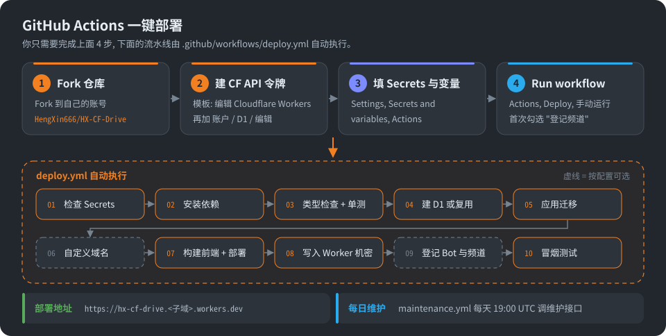
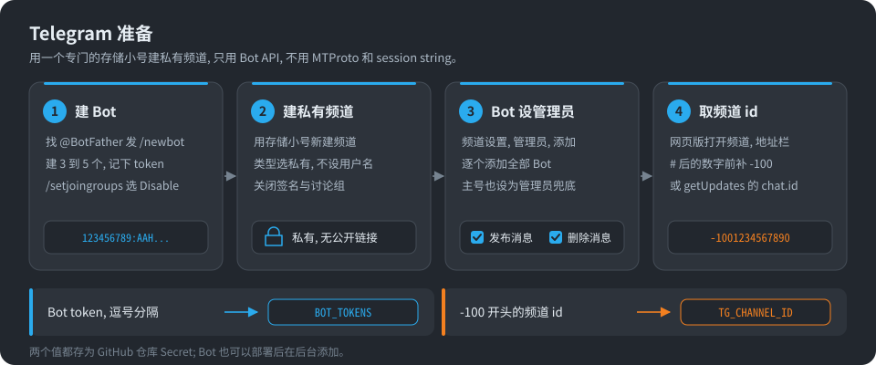
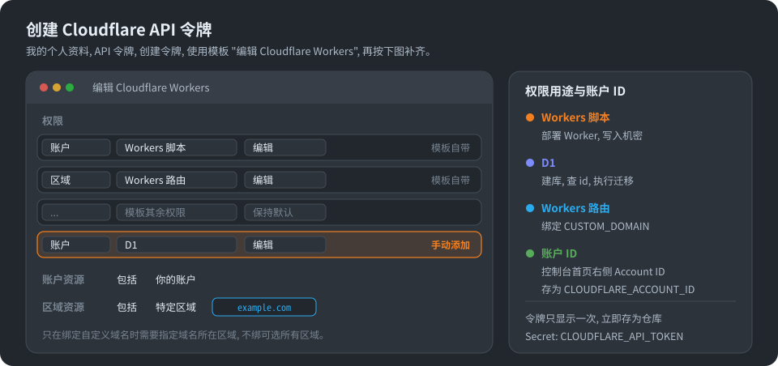

# 🚀 部署指南

全程只用 Cloudflare 免费计划里的 Workers + D1, 不需要 R2 和 Durable Object, 不用绑定支付方式。推荐用 GitHub Actions 一键部署, 你只需要一个 Cloudflare 账号, 一个 GitHub 账号和一个 Telegram 账号。

> [!WARNING]
> **条款提示**: Cloudflare 自助服务条款要求非企业用户通过付费服务 (含 Developer Platform) 分发视频和大文件, 否则 CDN 可能被限制。大量放视频建议上 Workers Paid ($5/月)。

<p align="center"></p>

> [!TIP]
> 部署前想先看看界面, 可以打开 [在线演示 (纯前端)](https://hengxin666.github.io/HX-CF-Drive/): 它由 `.github/workflows/pages.yml` 用 `VITE_DEMO=1` 构建并发布到 GitHub Pages, 接口全在浏览器内模拟, 数据只存在本地, 不连接任何后端或 Telegram。本地预览: `cd web && npm run build:demo && VITE_DEMO=1 npx vite preview`。

**目录**

1. [准备 Telegram](#1-准备-telegram)
2. [创建 Cloudflare API 令牌](#2-创建-cloudflare-api-令牌)
3. [Fork 并填写 Secrets 与 Variables](#3-fork-并填写-secrets-与-variables)
4. [运行部署工作流](#4-运行部署工作流)
5. [登录前端](#5-登录前端)
6. [已知的坑](#6-已知的坑)
7. [绑定自定义域名](#7-绑定自定义域名-强烈建议)
8. [手动部署 (备选)](#8-手动部署-备选)
9. [常用配置](#9-常用配置)
10. [验证与监控](#10-验证与监控)
11. [升级与回滚](#11-升级与回滚)
12. [备份](#12-备份)

---

## 1. 准备 Telegram

<p align="center"></p>

1. **建 Bot**: 在 Telegram 里找 `@BotFather`, 发 `/newbot` 按提示起名, 拿到形如 `123456789:AAH...` 的 token。建议建 3 到 5 个, 每个都发一次 `/setjoingroups` 选 Disable。
2. **建私有频道**: 用一个专门的存储小号新建频道, 类型选 **私有**, 不设公开用户名, 在频道设置里关闭 "签名" 和 "讨论组"。
3. **Bot 设管理员**: 频道设置, 管理员, 添加管理员, 逐个搜索 Bot 用户名添加, 至少勾选 "发布消息" 和 "删除消息"。主号也加为管理员, 小号出问题时频道不会丢。
4. **取频道 id**: 频道 id 是 `-100` 开头的一串数字, 任选一种方式:
   - 网页版 `web.telegram.org/a/` 打开频道, 地址栏 `#` 后面的数字前补 `-100` (已经是 `-100` 开头就直接用)。
   - 在频道里发一条消息, 访问 `https://api.telegram.org/bot<TOKEN>/getUpdates`, 找 `channel_post.chat.id` (该 Bot 不能设置了 webhook)。

> [!TIP]
> 只用 Bot API, 不要用 MTProto 和 session string, 后者泄露就等于丢号。账号结构, 风控和扩容见 [TELEGRAM.md](TELEGRAM.md)。

## 2. 创建 Cloudflare API 令牌

<p align="center"></p>

1. 记下 **账户 ID**: Cloudflare 控制台首页右侧的 "Account ID"。
2. 我的个人资料, API 令牌, 创建令牌, 选模板 **"编辑 Cloudflare Workers"**。
3. 在权限里再加一行 **`账户 / D1 / 编辑`**。
4. 账户资源选 "包括, 你的账户"。
5. 区域资源: 要绑定自定义域名时选 "包括, 特定区域, 你的域名" (或所有区域); 不绑可保持模板默认。
6. 创建后令牌只显示一次, 立即复制。

## 3. Fork 并填写 Secrets 与 Variables

Fork [HengXin666/HX-CF-Drive](https://github.com/HengXin666/HX-CF-Drive) 到自己的账号, 打开 Fork 后仓库的 Settings, Secrets and variables, Actions。

| 类型 | 名称 | 必填 | 值 |
| --- | --- | --- | --- |
| Secret | `CLOUDFLARE_API_TOKEN` | 是 | 第 2 步的 API 令牌 |
| Secret | `CLOUDFLARE_ACCOUNT_ID` | 是 | 账户 ID |
| Secret | `ADMIN_TOKEN` | 是 | 管理员令牌, `openssl rand -base64 32` 生成, 也是前端登录密码 |
| Secret | `SIGNING_KEY` | 是 | 直链签名密钥, 同上生成; 改了旧直链全部失效 |
| Secret | `BOT_TOKENS` | 否 | 逗号分隔的 Bot token, 也可部署后在后台添加 |
| Secret | `TG_CHANNEL_ID` | 否 | 存储频道 id (`-100...`), 手动运行勾选 "登记频道" 时用 |
| Variable | `DEPLOY_ENABLED` | 否 | 设为 `true` 后 push 到 main 自动部署, 每日维护也才会运行; 不设只能手动触发 |
| Variable | `CUSTOM_DOMAIN` | 否 | 绑定的自定义域名, 如 `drive.example.com`, 需托管在同一 CF 账户 |
| Variable | `PUBLIC_URL` | 否 | 服务的公开地址; 冒烟, 初始化和每日维护都走这个地址, 启用每日维护时必填 |
| Variable | `D1_NAME` | 否 | D1 库名, 默认 `hx-cf-drive` |
| Variable | `CF_CRON` | 否 | 设为 `true` 才用 CF Cron 做定时维护; 默认由 maintenance.yml 每 6 小时调接口 |

也可以用 gh 命令行设置:

```bash
gh secret set CLOUDFLARE_API_TOKEN
gh secret set CLOUDFLARE_ACCOUNT_ID
openssl rand -base64 32 | gh secret set ADMIN_TOKEN
openssl rand -base64 32 | gh secret set SIGNING_KEY
gh secret set BOT_TOKENS
gh secret set TG_CHANNEL_ID
gh variable set DEPLOY_ENABLED --body true
gh variable set PUBLIC_URL --body https://hx-cf-drive.<子域>.workers.dev  # 首次部署后再填也可以
```

> [!IMPORTANT]
> `ADMIN_TOKEN` 和 `SIGNING_KEY` 请自己另存一份。仓库 Secrets 写入后无法再读出, 前端登录要用 `ADMIN_TOKEN`。

## 4. 运行部署工作流

打开 Actions, 选 **Deploy**, 点 **Run workflow**, 首次勾选 **"部署后把 TG_CHANNEL_ID 登记为存储频道"**。工作流 `.github/workflows/deploy.yml` 会依次:

| 步骤 | 做什么 |
| --- | --- |
| 检查 Secrets | 4 个必填 Secret 缺任何一个都会直接报错退出 |
| 安装与测试 | `npm ci`, 类型检查, 单元测试 |
| 准备 D1 | D1 不存在就创建, 把 id 写进 CI 里的 `wrangler.toml` 副本, 再应用迁移; 仓库里的 `database_id` 不用填 |
| 自定义域名 | 设了 `CUSTOM_DOMAIN` 才执行 |
| Cron 设置 | 默认清空 `crons`, 不占账户 Cron 名额 |
| 构建并部署 | 构建前端到 `dist/web`, `wrangler deploy` |
| 写入机密 | `wrangler secret bulk` 写入 `ADMIN_TOKEN`, `SIGNING_KEY`, `BOT_TOKENS` |
| 初始化 Bot 与频道 | 仅勾选时执行: 同步 Bot 并登记频道, 输出每个 Bot 的管理员状态 |
| 冒烟 | 访问首页与 `/api/v1/admin/stats`, 把部署地址写进运行摘要 |

日志最后会列出每个 Bot 在频道里的状态, 都是 `ok` 即完成。部署地址在运行摘要里, 形如 `https://hx-cf-drive.<子域>.workers.dev`。之后 push 到 main 会自动部署 (需 `DEPLOY_ENABLED=true`, 只改文档不会触发)。

## 5. 登录前端

打开部署地址, 在登录页输入 **`ADMIN_TOKEN`** 即可进入。日常使用和接入第三方工具时, 建议在后台 "令牌" 页另建受限 API 令牌 (登录页同样接受), 不要把管理员令牌到处分发。

> [!IMPORTANT]
> 本次升级加了迁移 `0002_channel_sweep.sql` (`channels.sweep` 列) 和 `0003_blob_parts.sql` (分段清单表)。部署工作流会自动执行 `d1 migrations apply`; 手动部署记得先跑 `npm run db:migrate`。

## 6. 已知的坑

> [!NOTE]
> **Free 账户只有 5 个 Cron 触发器**。工作流默认把 `crons` 清空, 改由 `.github/workflows/maintenance.yml` 每 6 小时调 `POST /api/v1/admin/maintenance`, 做 Bot 探活, 回收站清理, 孤儿分片删除和放弃上传的消息清扫; 返回 `more=1` 时接着调, 最多 20 次。间隔不能超过 48 小时 (TG 只允许 Bot 删除 48 小时内的消息)。它要求 `DEPLOY_ENABLED=true` 且设置了 `PUBLIC_URL`。想改用 CF Cron, 把变量 `CF_CRON` 设为 `true`。
>
> 公开仓库 60 天无活动, GitHub 会自动禁用定时工作流。`.github/workflows/keepalive.yml` 每周一用 API 重新启用 maintenance.yml 和它自己, 不产生提交。

> [!WARNING]
> **Cloudflare 会对 curl, node 的默认 User-Agent 弹人机验证**, 返回一个 HTML 页面而不是 JSON。所有脚本都要带自定义 UA: 工作流用 `hx-cf-drive-ci/1`, 命令行 `hxd` 用 `hxd/1`。自己写脚本时加上 `curl -A "my-tool/1"` 或在请求头里设 `User-Agent`。

> [!TIP]
> **`*.workers.dev` 上 Cache API 不生效**。只有设 `EDGE_CACHE=1` 时才用得上边缘缓存, 而且需要绑定自定义域名, 见下一节。

> [!CAUTION]
> **改 `SIGNING_KEY` 会让所有旧直链失效**。已经发出去的 `/f/:id` 签名直链需要重新生成, 所以部署后不要随意轮换它。

## 7. 绑定自定义域名 (强烈建议)

`*.workers.dev` 上 Cache API 不生效。默认 `EDGE_CACHE=0`, 靠 isolate 内存缓存 file_path 和清单; 设 `EDGE_CACHE=1` 后永久直链的小文件会写入边缘缓存, 只在自定义域名上有效。

- **用工作流**: 域名托管到同一 Cloudflare 账户, API 令牌的区域资源包含该域名, 设置变量 `CUSTOM_DOMAIN=drive.example.com` 和 `PUBLIC_URL=https://drive.example.com`, 重新运行 Deploy。
- **手动**: Workers 后台选中 `hx-cf-drive`, 设置, 域和路由, 添加自定义域。

## 8. 手动部署 (备选)

用了 GitHub Actions 可以跳过本节。手动部署需要 Node.js 18+。

<details>
<summary><b>展开手动部署步骤</b></summary>

### 8.1 安装与登录

```bash
npm install
npm install --prefix web
npx wrangler login
```

### 8.2 创建 D1

```bash
# 把输出的 database_id 填进 wrangler.toml
npx wrangler d1 create hx-cf-drive
```

```toml
[[d1_databases]]
binding = "DB"
database_name = "hx-cf-drive"
database_id = "这里换成上一步输出的 id"
```

Free 账户 Cron 名额紧张时, 把 `wrangler.toml` 里的 `crons` 改成 `[]`, 再按第 6 节用外部定时调维护接口。

### 8.3 建表

```bash
npm run db:migrate        # 远程
npm run db:migrate:local  # 本地开发
```

### 8.4 设置机密

```bash
# 管理员令牌, 用随机长字符串
openssl rand -base64 32 | npx wrangler secret put ADMIN_TOKEN
# 直链签名密钥, 改了之后所有旧直链失效
openssl rand -base64 32 | npx wrangler secret put SIGNING_KEY
# Bot 令牌, 逗号分隔 (也可以部署后在后台添加)
npx wrangler secret put BOT_TOKENS
```

### 8.5 部署

```bash
npm run deploy  # 先构建前端到 dist/web, 再 wrangler deploy
```

输出里的 `https://hx-cf-drive.<你的子域>.workers.dev` 就是服务地址。

### 8.6 初始化 Telegram 频道

```bash
BASE=https://hx-cf-drive.xxx.workers.dev
ADMIN=你的管理员令牌
UA="hx-cf-drive-cli/1"  # 自定义 UA, 避免人机验证

# 把 BOT_TOKENS 写进数据库并探活
curl -A "$UA" -X POST -H "Authorization: Bearer $ADMIN" $BASE/api/v1/admin/maintenance

# 添加频道, 返回里会检查每个 Bot 是否为管理员
curl -A "$UA" -X POST -H "Authorization: Bearer $ADMIN" -H "Content-Type: application/json" \
  -d '{"id":"-1001234567890"}' $BASE/api/v1/admin/channels

# 查看状态
curl -A "$UA" -H "Authorization: Bearer $ADMIN" $BASE/api/v1/admin/stats
```

`channels` 里每个 Bot 都显示 `ok` 才算配置完成。

</details>

## 9. 常用配置

在 `wrangler.toml` 的 `[vars]` 里修改:

| 变量 | 默认 | 说明 |
| --- | --- | --- |
| `CHUNK_SIZE` | 19922944 | 分片字节数, 超过 19 MiB 会被压回 19 MiB |
| `SUBREQ_BUDGET` | 48 | 单次响应可用的外部子请求数。Free 上限 50, Paid 默认 10,000 |
| `SEARCH_PER_MIN` | 6 | 每个令牌每分钟模糊搜索次数 |
| `TRASH_DAYS` | 7 | 回收站保留天数 |
| `EDGE_CACHE` | 0 | 1 = 永久直链小文件写入边缘缓存, 仅自定义域名有效 |
| `D1_METER` | 空 | 1 = 响应头 `X-D1-Rows` 带本请求的 D1 查询数和行读写, 只在排查时开 |

## 10. 验证与监控

```bash
# 端到端冒烟 (会往频道真实发消息, 建议先用测试频道)
BASE=$BASE ADMIN=$ADMIN CHANNEL=-100xxxx node scripts/e2e.mjs

# 实时日志, 关注 cpuTime 和 429
npx wrangler tail

# 实测每个操作的 D1 行读写 (需 D1_METER=1, 会建测试目录)
BASE=$BASE ADMIN=$ADMIN node scripts/meter.mjs 200
```

## 11. 升级与回滚

- **用工作流**: 在 Fork 上同步上游 (Sync fork); 设了 `DEPLOY_ENABLED=true` 时 push 到 main 会自动部署, 没触发就在 Actions 里手动 Run workflow。新迁移由 "准备 D1" 步骤自动应用。
- **手动**:

```bash
git pull && npm install
npm run db:migrate     # 有新迁移时
npm run deploy
npx wrangler rollback  # 回滚到上一个版本
```

## 12. 备份

```bash
# 导出 D1 (目录树是唯一不可再生的数据, 务必定期备份)
npx wrangler d1 export hx-cf-drive --remote --output backup-$(date +%F).sql
```

TG 频道里的分片按 blob id 命名, 分片清单在 D1 的 `blobs.manifest` 里, 只要 D1 备份在, 数据就能找回。
