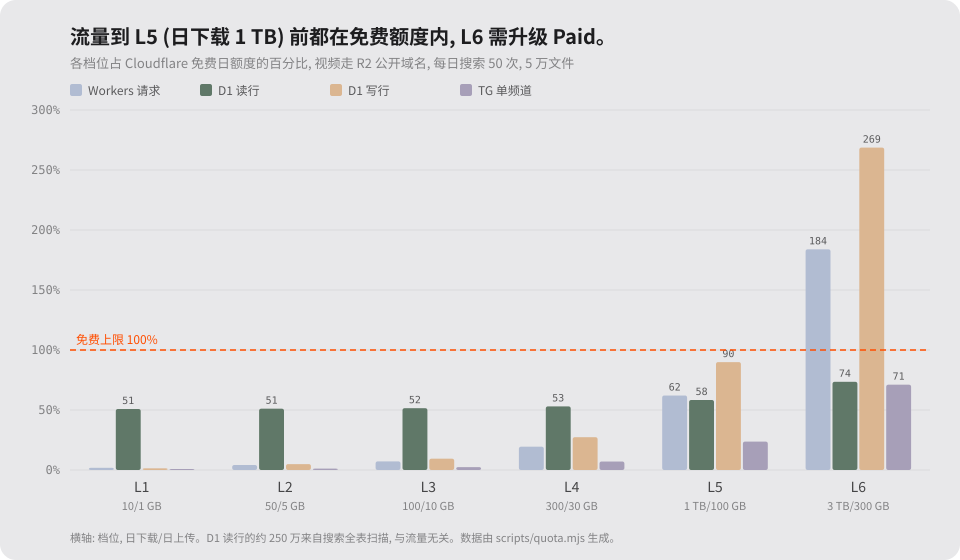

# 请求量, 增长坡度与免费额度

所有数字都可以用 `node scripts/quota.mjs 参数=值` 重新计算。下表的每次操作行数是按代码路径数出来的估计值, 上线后请以 Cloudflare 后台的实际用量为准。

## 1. 基准负载

| 参数 | 取值 |
| --- | --- |
| 每日下载 | 100 GB |
| 每日上传 | 10 GB |
| 视频占比 (按字节) | 60% |
| 图片平均 | 8 MB (2 到 20 MB) |
| 视频平均 | 200 MB (50 到 500 MB) |
| 播放器单次 Range | 平均 16 MB |
| 路由 | 视频走 R2, 图片走 TG |
| 文件总数 | 5 万 |
| 每日搜索 | 50 次 |

推导出的每日动作:

- 图片下载: 100 GB x 40% / 8 MB ≈ 5,120 次。
- 视频 Range 请求: 100 GB x 60% / 16 MB ≈ 3,840 次。
- 图片上传: 4 GB / 8 MB ≈ 512 个, 每个 1 片。
- 视频上传: 6 GB / 200 MB ≈ 31 个, 每个 13 片。

## 2. 免费额度占用 (视频走 R2 公开域名)

| 项目 | 每日用量 | 免费额度 | 占用 | 余量倍数 |
| --- | --- | --- | --- | --- |
| Workers 请求 | 7,239 | 100,000/日 | 7.2% | 13.8x |
| D1 读行 | 2,572,852 | 5,000,000/日 | 51.5% | 1.9x |
| D1 写行 | 9,420 | 100,000/日 | 9.4% | 10.6x |
| DO 请求 | 538 | 100,000/日 | 0.5% | 186x |
| R2 A 类操作 | 13,824/月 | 1,000,000/月 | 1.4% | 72x |
| R2 B 类操作 | 115,200/月 | 10,000,000/月 | 1.2% | 87x |
| TG 消息 (单频道) | 512 | 21,600/日 | 2.4% | 42x |

关键结论:

- D1 读行里有 250 万来自搜索 (50 次 x 5 万行全表扫描)。不算搜索只有约 7 万行, 占 1.4%。搜索是唯一需要注意的地方, 文件多了之后要限制搜索频率或改用 FTS5 索引。
- 视频不走公开域名, 而是全部经过 Worker 时, Workers 请求升到 11,079 (11.1%), 依然宽裕。
- 视频改存 TG (`ROUTE_VIDEO_TO=tg`) 时, R2 增长为 0, TG 消息升到 911/日, Workers 请求 11,079。

## 3. 阶梯等级与增长坡度

各项用量与流量基本线性, 只有搜索与流量无关。按档位 (日下载 / 日上传, 其他假设同上):

| 档位 | 日下载 / 上传 | Workers 请求 | D1 读行 | D1 写行 | TG 单频道 | R2 每月增长 | R2 首年存储费 | 计划 |
| --- | --- | --- | --- | --- | --- | --- | --- | --- |
| L1 | 10 GB / 1 GB | 1.8% | 50.8% | 1.4% | 0.2% | 18 GB | $19 | Free |
| L2 | 50 GB / 5 GB | 4.2% | 51.1% | 4.9% | 1.2% | 90 GB | $104 | Free |
| L3 (基准) | 100 GB / 10 GB | 7.2% | 51.5% | 9.4% | 2.4% | 180 GB | $209 | Free |
| L4 | 300 GB / 30 GB | 19.4% | 53.0% | 27.3% | 7.1% | 540 GB | $630 | Free |
| L5 | 1 TB / 100 GB | 62.1% | 58.3% | 89.9% | 23.7% | 1.8 TB | $2,104 | Free, 接近上限 |
| L6 | 3 TB / 300 GB | 183.9% | 73.5% | 268.7% | 71.1% | 5.4 TB | $6,316 | Paid $5/月 |

- 先撞线的是 D1 写行 (L5 到 90%), 其次是 Workers 请求 (L6 超出)。
- L6 改用 Workers Paid ($5/月): 含每月 1000 万请求 (约 33 万/日) 和 5000 万 D1 写行 (约 166 万/日), 足够覆盖。
- TG 单频道在 L6 到 71%, 加到 2 到 3 个频道即可。
- 从 L4 起 R2 存储费成为主要成本, 远超 Workers。此时建议 `ROUTE_VIDEO_TO=tg`, R2 只放热门视频, 存储费可接近 0。

## 4. R2 存储费用

R2 免费 10 GB, 超出 $0.015/GB-月, 出站流量免费。视频每天 6 GB 进 R2, 每月增长约 180 GB:

| 月份 | 累计 | 当月费用 |
| --- | --- | --- |
| 1 | 180 GB | $2.6 |
| 6 | 1,080 GB | $16.1 |
| 12 | 2,160 GB | $32.3 |

首年存储费合计约 $209。想压到接近 0, 有两条路:

1. `ROUTE_VIDEO_TO=tg`, 视频也进 TG。代价是拖动时首包多一次 getFile, 慢 0.3 到 1 秒。
2. 只把常看的视频放 R2, 冷视频定期用 API 移到 TG (后续版本做自动冷热迁移)。

## 5. 性能评判

| 场景 | 预期表现 | 依据 |
| --- | --- | --- |
| 图片直链 (自定义域名, 缓存命中) | 首字节约 20 到 50 ms | Cache API 命中, 不访问 TG |
| 图片直链 (缓存未命中) | 首字节约 300 到 800 ms | D1 查询 + getFile (50 分钟缓存) + 从 TG 拉取 |
| 视频 (R2 公开域名) | 与 R2 原生相同 | 完全不经过 Worker |
| 视频 (TG) 拖动 | 每次拖动多 0.3 到 1 秒 | 每个 Range 要定位分片并回源 TG |
| 上传吞吐 (TG) | 单频道约 4 MB/s 持续 | 15 片/分 x 16 MB, 加频道线性提升 |
| 上传吞吐 (R2) | 受客户端带宽限制 | multipart 直写 |

CPU (免费计划 10 ms/请求):

- 读取用 `FixedLengthStream` 和 R2 原生流, 字节搬运不经过 JS, CPU 主要花在 D1 查询和 JSON 上。
- 上传每片要把 16 MB 读入内存再组 FormData, 这是最吃 CPU 的路径。这部分我没能在线上实测, 部署后请用 `wrangler tail` 查看 `cpuTime`。如果经常超 10 ms, 把 `CHUNK_SIZE` 降到 8 MB 或升级 Paid。
- 服务端加密不在免费计划里做, 需要加密请在客户端做。

## 6. 本地验证情况

- `tsc --noEmit` 通过, 22 个单元测试通过 (Range 映射, 签名, 路由, 流切片)。
- 用 `scripts/mock-tg.mjs` 模拟 Telegram, 本地端到端已验证: 鉴权, 添加频道, 图床式上传, 签名直链, 篡改签名拒绝, 40 MB 三分片上传, 跨分片 Range。
- 后半段 (秒传, R2 视频, WebDAV, 受限令牌, 分享) 在我的测试沙箱里因为本地 workerd 打开文件数上限 (4096) 中断, 尚未跑完。请在你本机执行 `node scripts/e2e.mjs` 补跑一遍。
